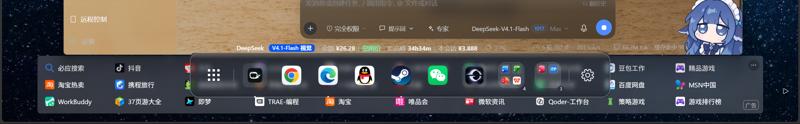

# DesktopDock

Windows 桌面美化小工具：**玻璃态 Dock 图标栏** + **应用抽屉** + **任务栏自动隐藏跟随**。
纯 WPF / C#，不需要 Visual Studio、不需要 csproj，用系统自带的 `csc.exe` 直接编译成一个 exe。



## 功能

| 模块 | 说明 |
|---|---|
| Dock 图标栏 | 底部居中玻璃栏，图标随鼠标放大；固定常用项，其余自动从开始菜单/常用度排序 |
| 应用抽屉 | 点栏首格（或左上热角）打开全屏应用网格，支持拼音首字母搜索，117+ 应用分页加载 |
| 热角 | 四角可配置：抽屉 / Dock / 无；默认右下角唤出 Dock |
| 热键 | `Alt+\`` 唤出抽屉，`Alt+Space` 唤出 Dock |
| 全屏与最大化让开 | 前台是 F11/视频全屏或最大化窗口时，Dock 和把手一律收起 |
| 任务栏自动隐藏跟随 | 在桌面时任务栏自动隐藏；切到应用（浏览器等）时任务栏转为常显 —— 通过 `SHAppBarMessage(ABM_SETSTATE)` 改**活状态**，不动注册表，退出时还原 |
| 玻璃/亚克力 | 截屏模糊 + 色调叠加；带 DPI 感知、blur 降采样 |

## 系统要求

- Windows 10 / 11（x64）
- .NET Framework 4.8（Win10 1803+ 自带）
- 构建只需要系统里的 `%WINDIR%\Microsoft.NET\Framework64\v4.0.30319\csc.exe`

## 构建

```powershell
cd D:\DesktopDock
powershell -NoProfile -ExecutionPolicy Bypass -File .\build.ps1
# -> D:\DesktopDock\build\DesktopDock.exe
```

`build.ps1` 会把 `src\*.cs` 全量编译成 `winexe`，引用 GAC 里的 `PresentationCore` / `PresentationFramework` / `WindowsBase` / `System.Xaml`。
**语法底线是 C# 5**（老 csc）：不能用 `$"..."` 字符串插值、`?.`、`nameof`、表达式体成员。

## 运行与调试

- 配置：`%APPDATA%\DesktopDock\settings.json`（首次运行生成，字段见 `src\Apps.cs` 的 `DockSettings`）
- 日志：`%APPDATA%\DesktopDock\dock.log`（每次启动追加，可用来对时间线）
- 重启：`Get-Process DesktopDock | Stop-Process -Force; Start-Process .\build\DesktopDock.exe`

## 目录结构

```
build.ps1            构建脚本（csc 直编）
src/
  DockWindow.cs      主窗口：场景裁决 ResolveMode、Tick、玻璃壳、热角、看门狗
  DrawerWindow.cs    应用抽屉（网格 / 搜索 / 分页）
  Native.cs          所有 Win32 P/Invoke：全屏/最大化判定、任务栏、窗口样式
  Glass.cs           截屏模糊与色调
  Apps.cs            开始菜单扫描、固定项、settings.json 读写
  ...
docs/                机制说明、截图
```

## 已知问题

- **托盘图标**：长时间运行后可能挂不上（`dock.log` 里 `tray: re-add ... ok=False`），重启进程可恢复，根因未查。
- **DPI**：150% 缩放下，`SHAppBarMessage` 只认物理像素；早期"底部 AppBar 占位"方案已弃用（会让自动隐藏的任务栏被顶成常显）。
- **全屏判定**：`SHQueryUserNotificationState` 只作补充判据（游戏最小化后仍报 busy，单独用会把 Dock 永久藏掉）；目前是「矩形铺满 + 无标题栏」为主、QUNS 为辅，并带 3px 容差。

## 参与贡献

欢迎 Issue / PR。报问题时请附：

1. Windows 版本（`winver`）与缩放比例
2. `%APPDATA%\DesktopDock\dock.log` 里出问题前后的 20~30 行
3. 复现步骤（是否全屏、是否最大化、前台是哪个程序）

想改代码的话，优先看这几处：

- `src\DockWindow.cs` 的 `ResolveMode()` —— 所有"该不该显示"的唯一裁决点
- `src\Native.cs` 的 `IsFullscreenAppForeground()` / `IsForegroundMaximized()`
- `src\DockWindow.cs` 的 `UpdateTaskbarAutoHide()` —— 任务栏自动隐藏跟随

## 许可

MIT，见 [LICENSE](LICENSE)。
